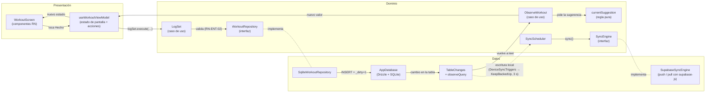
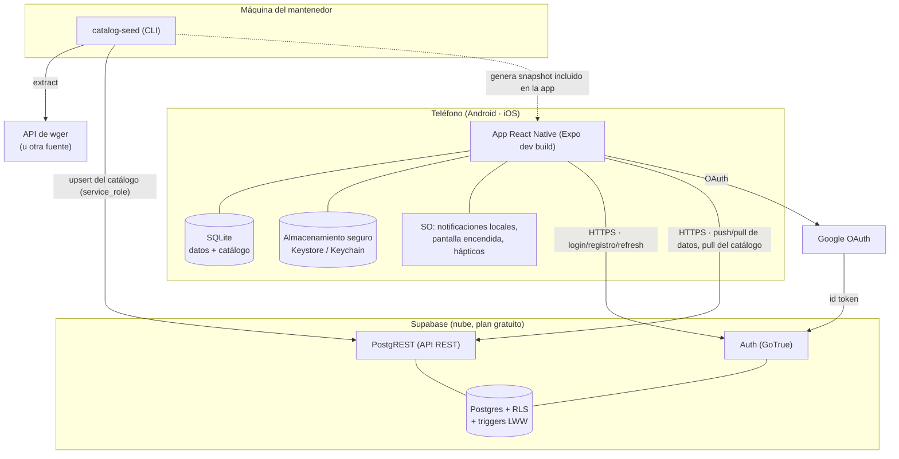

# 12 — Arquitectura

Responde al §4.11 del TPO: diagramas de **flujo de datos** y de **topología de infraestructura**, y las responsabilidades de cada capa.
**ADR:** [0011](adr/0011-mvvm-clean-en-react-native.md) (capas y estado), [0013](adr/0013-estructura-objetivo-de-la-arquitectura.md) (estructura y lo que no se cambia), [0010](adr/0010-base-local-sqlite-drizzle.md) (base local), [0009](adr/0009-motor-como-funcion-pura.md) (motor), [0001](adr/0001-supabase-directo-sin-backend-propio.md) (remoto), [0007](adr/0007-react-native-con-expo.md) (Expo), [0012](adr/0012-soporte-ios.md) (iOS).

## 1. Capas y responsabilidades

| Capa | Contiene | Depende de | No puede depender de |
|---|---|---|---|
| **Presentación** | Pantallas por feature (`features/<feature>/`), piezas que comparten varias features (`shared/`), sistema de diseño (`components/`), **ViewModels** (hooks `useXViewModel`), estado de pantalla, textos | Dominio (casos de uso, modelos) | Datos, SDKs de Supabase o SQLite. Una feature no importa otra, salvo las excepciones del lint |
| **Dominio** | Modelos, **reglas** por tema (motor, próximo día, e1RM, volumen), **casos de uso** por feature, **interfaces de repositorios** (`repositories/`, uno por agregado) y **de servicios** (`services/`: autenticación, permisos, aviso y cuenta regresiva del descanso, base local, sync) | Nada (TypeScript puro) | Presentación, Datos, React, Expo |
| **Datos** | Repositorios sobre SQLite (`Sqlite…Repository`, con Drizzle), mappers fila ↔ modelo, motor de sync con supabase-js, autenticación, servicios del dispositivo y la configuración de la infraestructura (variables de entorno, SDKs, listeners del sistema) | Dominio (implementa sus interfaces) | Presentación |
| **Composition root** (`src/di`) | Crea las implementaciones, arma los casos de uso por grupo y los provee por Context. Solo compone | Todas las capas | — |

**Regla de dependencias** (Clean Architecture): las flechas apuntan **hacia el dominio**. Se verifica con lint en CI (RNF-11).

## 2. Flujo de datos

Ejemplo: confirmar una serie (RF-ENT-02).



**Por qué así:**
- La UI **nunca espera a la red**: la escritura termina en SQLite y la UI se actualiza porque **observa** la base local (RN-SYNC-01).
- La sync es un proceso **aparte** de la interacción.
- El motor está en el dominio y no conoce ni SQLite ni React, así que se prueba con tablas de casos (RNF-15).

## 3. Topología de infraestructura



**No hay backend propio** (ADR-0001). La app **nunca** habla con wger (ADR-0004).

## 4. Estado (MVVM)

| Tipo de estado | Dónde vive | Ejemplo |
|---|---|---|
| **Estado de pantalla** | ViewModel (hook) | `{ status: 'loading' \| 'content' \| 'empty' \| 'error', data, … }` de la pantalla de historial |
| **Estado global de la app** | Store de Zustand (`presentation/state/app-store.ts`) | dueño de los datos (invitado o usuario, con la sesión vencida), estado de sync, pedidos de unión del invitado |
| **Datos persistentes** | SQLite (fuente de verdad) | rutinas, entrenamientos, el entrenamiento en curso y el fin del descanso (RN-SYNC-01: se observan, no se copian al store) |
| **Datos derivados** | Se calculan en el dominio | sugerencias, próximo día |
| **Estado efímero de UI** | `useState` del componente | texto del buscador, modal abierto |

Cada ViewModel expone un **estado explícito como unión discriminada** y **acciones**:

```ts
type HistoryState =
  | { status: 'loading' }
  | { status: 'empty' }
  | { status: 'content'; workouts: WorkoutSummary[] }
  | { status: 'error'; message: string; retry: () => void };

function useHistoryViewModel(): { state: HistoryState; openWorkout(id: string): void } { /* … */ }
```

## 5. Estructura de carpetas

La fijó [ADR-0013](adr/0013-estructura-objetivo-de-la-arquitectura.md) en F11. El lint vigila las capas, los imports entre features y el código de prueba (RNF-11).

```
app/                         # Expo Router: compone la pantalla y conecta la navegación con callbacks
src/
  domain/                    # TypeScript puro
    models/                  # Routine, Workout, Exercise, Profile, …
    rules/<tema>/            # suggestion/ (motor), workout/, progress/, routine/, sync/, …
    usecases/<feature>/      # workout/ (LogSet, ObserveWorkout…), routines/, auth/, sync/ (SyncScheduler), …
    repositories/            # interfaces *-repository, una por agregado
    services/                # puertos que no son repositorios: auth-gateway, sync-engine, rest-notifier, …
    observer.ts              # Observer y Unsubscribe, de repositorios y servicios
    testing/                 # fakes en memoria, solo para tests
  data/
    db/                      # schema.ts (Drizzle), AppDatabase, observeQuery, TableChanges
    repositories/            # Sqlite…Repository
    mappers/                 # fila ↔ modelo
    sync/                    # push, pull, SupabaseSyncEngine, unión del invitado, app-backup.ts
    auth/                    # SupabaseAuthGateway, sesión segura, app-supabase.ts (cliente y variables)
    device/                  # notificaciones, cuenta regresiva (Live Activity), permisos
    catalog/, calendar/
  presentation/
    features/<feature>/      # pantallas, useXViewModel y hooks use-* de la feature
    shared/                  # piezas que usan varias features
    components/              # sistema de diseño
    use-cases/               # contexto de casos de uso, un hook por grupo
    state/                   # store de Zustand
    strings/, theme/, navigation/, widgets/
  di/                        # composition root: crea repositorios, servicios y casos de uso, y los provee
drizzle/                     # migraciones de SQLite (generadas)
supabase/                    # migraciones de Postgres (tablas, RLS, triggers) y sus tests
tools/                       # catalog-seed (ADR-0004), perf, lint, CI
```
