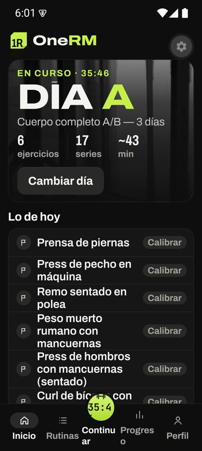
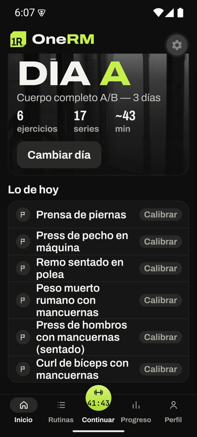
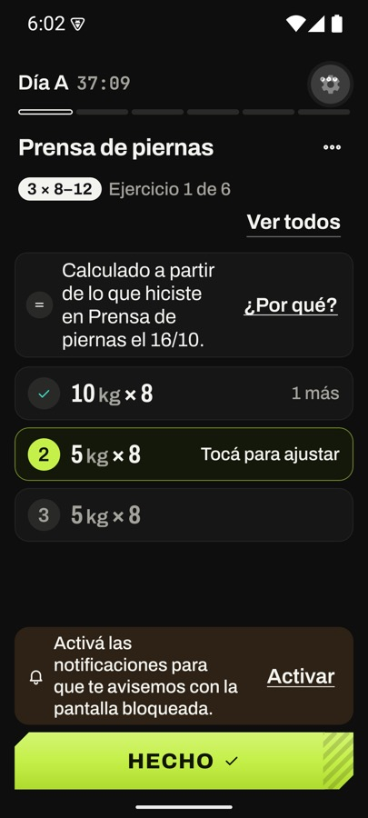
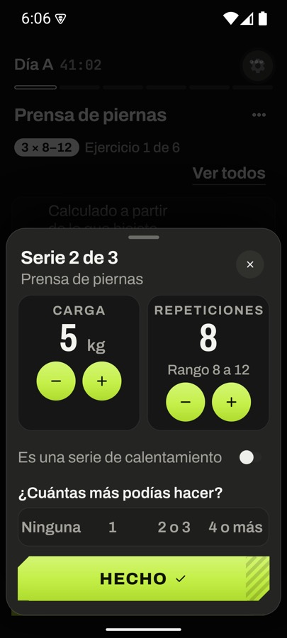
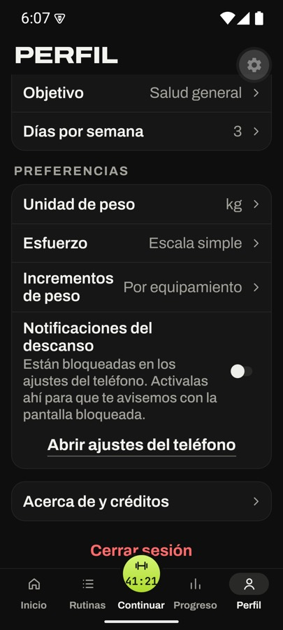
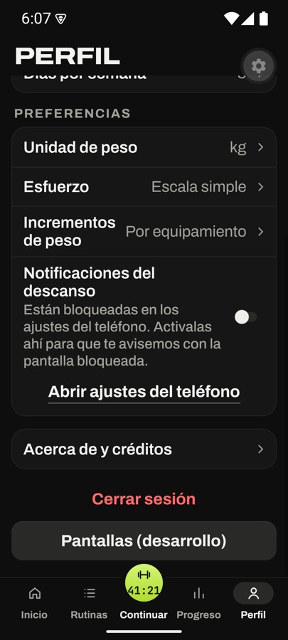

# Accesibilidad y fuente del sistema al 150 % (#48)

**Fecha:** 16 de octubre de 2026.
**Dispositivo:** emulador `OneRM_API35` (Android 15, 420 dpi) con el development build.
**Requisitos:** RNF-16 (blancos táctiles), RNF-17 (contraste) y RNF-18 (lector de pantalla y fuente al 150 %).

## Cómo se verificó

- **RNF-16 y RNF-18 (etiquetas):** `node tools/a11y/audit.mjs <pantalla>` lee el árbol de accesibilidad de la pantalla del emulador con `uiautomator dump --compressed`, que es el mismo árbol que recorre TalkBack: solo las vistas importantes para la accesibilidad. Lista cada nodo accionable con lo que lee el lector y su tamaño en dp, y marca los que no tienen etiqueta o miden menos de 48 dp. Se corrió en S07, S09 (con la hoja de la serie, el descanso, el menú del ejercicio, la lista de ejercicios y D05), S13, S14, S15, S17, S18, S21 y S22. Las pantallas que no se recorrieron (S01–S06, S08, S12, S16, S19, S20, S24) están hechas con los mismos componentes, que se midieron en las otras.
- **TalkBack** se encendió en el emulador para confirmar el foco. El recorrido nodo por nodo se hizo con el auditor, porque los gestos de TalkBack por `adb` no son confiables y en el emulador provocan ANR.
- **RNF-17:** cubierta por `src/presentation/theme/contrast.test.ts` (cada par de tokens de texto y fondo ≥ 4,5:1, y los bordes de los controles ≥ 3:1).
- **Fuente al 150 %:** `adb shell settings put system font_scale 1.5`, con capturas de S07, S09 (con la hoja de la serie) y S21.

## Hallazgos y correcciones

| # | Dónde | Problema | Corrección |
|---|---|---|---|
| 1 | `SectionTabs` (S13, S18) | Pestañas de 47 dp: el borde de 1 dp entraba en los 48 | 48 dp en cada pestaña |
| 2 | `Segmented` (esfuerzo) | Opciones de 46 dp | Padding 3: opciones de 48 dp y el grupo sigue en 56 |
| 3 | `TextField`, `SearchField` | La caja medía 52 dp, pero solo la línea de texto (23 dp) enfocaba el campo | El campo ocupa toda la altura |
| 4 | Interruptores (S21 y la hoja de la serie) | El `Switch` medía 46 × 27 dp | `SwitchRow`: toda la fila es el interruptor (rol `switch`) |
| 5 | «¿Por qué?» (S09) | 44 dp, más un `hitSlop` de 4 | 48 dp sin `hitSlop` |
| 6 | `Scrim` de hojas y diálogos | TalkBack lo enfocaba como un botón sin nombre | Fuera del árbol de accesibilidad; se cierra con «Cerrar» o con Atrás |
| 7 | Fila de serie (S09) | Se leía «10, kg, × 8, 1 más» | «Serie 1, hecha, 10 kg, × 8, 1 más» (13 §10) |
| 8 | Botón central de la barra | «Empezar» / «Continuar, 18:42» | «Empezar Día A» / «Continuar entrenamiento, 18:42» / «Empezar, no disponible» (13 §10) |
| 9 | Descanso minimizado | El tiempo era tocable pero no tenía rol de botón | Rol de botón |
| 10 | Barra de pestañas al 150 % | «Continu/ar», «Progres/o» y el tiempo del disco cortado | Textos en una línea, con un tope de 1,2× (es una barra de alto fijo) |
| 11 | Rótulos «CARGA» / «REPETICIONES» al 150 % | «REPETICIONE/S» en dos líneas | Se achica para entrar en una línea |

Después de las correcciones, el auditor no marca nada en las pantallas recorridas.

El botón flotante de engranaje que aparece en las capturas es de las herramientas de desarrollo de Expo: no está en la build de release.

## Fuente al 150 %

| | | |
|---|---|---|
|  Antes: la barra se cortaba |  S07 |  S09 |
|  S09, hoja de la serie |  S21 |  S21, final |

El parche del `Text` de la app (medio píxel al final, #85) se mantiene: al 150 % no se perdió ninguna palabra. Se retira cuando React Native incluya facebook/react-native#57117 (hoy 0.86.3).

## Pendiente para una persona

- Un recorrido escuchando TalkBack en un teléfono físico (orden de lectura y gestos). VoiceOver se prueba en #49.
