# Prueba de humo en el simulador de iOS (#49)

**Fecha:** 16 de octubre de 2026.
**Dispositivo:** simulador iPhone 17 (iOS 26.5), Xcode 27, development build con `npx expo run:ios`.
**Cómo:** el recorrido se manejó con [idb](https://fbidb.io), que toca la pantalla y lee el árbol de accesibilidad, el mismo que recorre VoiceOver. Las capturas son de `xcrun simctl io screenshot`.

## Resultado

| Paso | Resultado |
|---|---|
| Build | ✅ compila sin errores (1 aviso de Xcode del script de Expo Dev Launcher, propio del dev build) |
| Bienvenida → onboarding (3 pasos) → recomendación → «Empezar con esta rutina» | ✅ |
| Inicio con el próximo día; «Empezar Día A» | ✅ (tras corregir el acento de los títulos, abajo) |
| Entrenamiento: serie de calibración desde la hoja, esfuerzo, «Hecho», descanso, serie siguiente | ✅ |
| Matar la app y reabrirla: retoma el entrenamiento y el descanso (RNF-02) | ✅ |
| D05 (permiso de notificaciones) sobre el descanso, y el pedido del sistema | ✅ tras corregirlo (abajo) |
| **RNF-23:** aviso de fin de descanso con la pantalla bloqueada | ✅ llegó a **+120,3 s** para un fin en +120 s (≈ 0,3 s de retraso) |
| Finalizar con D10, resumen S12 y D13 (invitado) | ✅ |
| Progreso: historial, detalle S19, volumen semanal y progreso del ejercicio S20 | ✅ |
| Nombres para el lector (VoiceOver) | ✅ los de #48 se leen igual: «Empezar Día A», «Serie 1, hecha, 20 kg, × 8, 1 más» |

No hay código exclusivo de Android en el flujo: el módulo `exact-alarm` tiene su parte de iOS, que responde que no hacen falta alarmas exactas (RN-ENT-07).

## Corregido en este PR

| Qué pasaba en iOS | Por qué | Corrección |
|---|---|---|
| Los títulos de display perdían el acento de las mayúsculas («DIA A») | iOS corta lo que el glifo dibuja por encima de su caja de línea, y esas líneas son más bajas que la fuente; Android lo dibuja igual | En iOS las líneas de display miden al menos el 112 % de la fuente |
| Al arrancar, `RNGoogleSignin` fallaba: «failed to determine clientID» | iOS necesita su propio client ID de Google (ADR-0012) y no hay uno creado | En iOS el selector de Google solo se crea si está `EXPO_PUBLIC_GOOGLE_IOS_CLIENT_ID` |
| D05 y D17 no aparecían nunca: el descanso seguía sin pedir el permiso | iOS no presenta un `Modal` mientras otro está abierto, y el descanso a pantalla completa es un `Modal` | Los diálogos de permiso van dentro del `Modal` del descanso cuando está a la vista |

## Limitaciones conocidas en iOS

- **«Continuar con Google» no funciona en iOS** hasta crear un cliente OAuth de iOS en Google Cloud (con su URL scheme, ADR-0012) y ponerlo en `EXPO_PUBLIC_GOOGLE_IOS_CLIENT_ID`. Hoy el botón termina en el error genérico. Email y contraseña funcionan.
- **Opciones de esfuerzo con VoiceOver:** React Native no tiene un rasgo «radio» en iOS. Las opciones se leen por su nombre, pero no como «botón de opción».
- **Sin Sign in with Apple:** no aplica porque la app no se publica (ADR-0012).
- **No se probó en un iPhone físico** (hace falta un Apple ID y firmar la app) ni con el modo de bajo consumo.
- En el dev build, el botón flotante de las herramientas de Expo tapa el menú «Entrenamiento» de S09, igual que en Android. No existe en la build de release.

## Capturas

| | | |
|---|---|---|
|  S01 |  S06 | 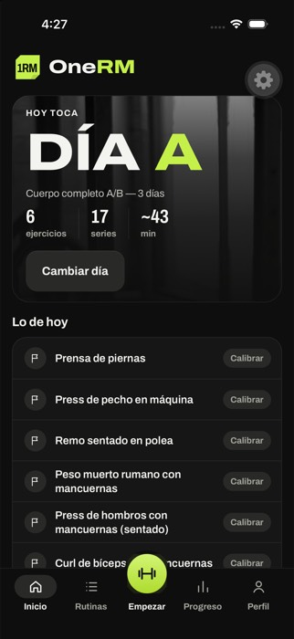 S07 («DÍA A» corregido) |
| 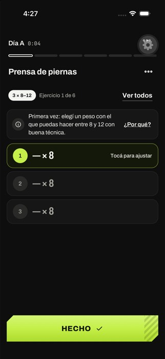 S09 | 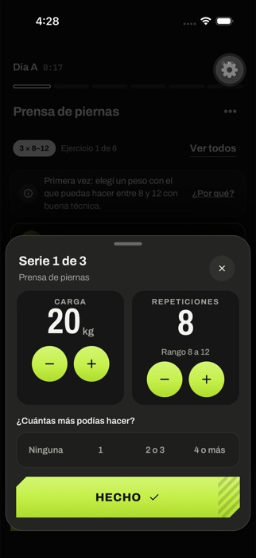 Hoja de la serie | 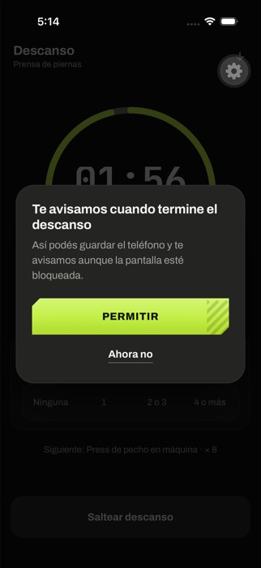 D05 sobre el descanso |
| 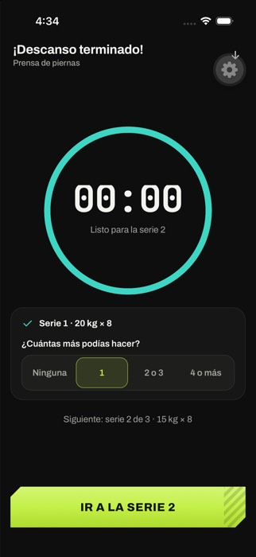 Descanso terminado | 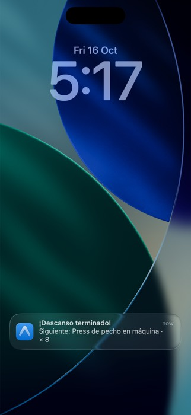 RNF-23, pantalla bloqueada | 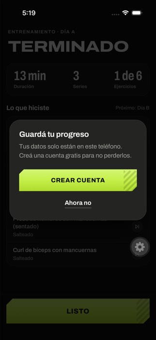 S12 con D13 |
| 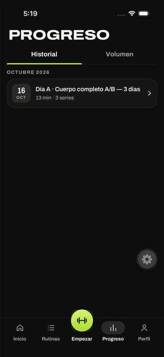 S18 | 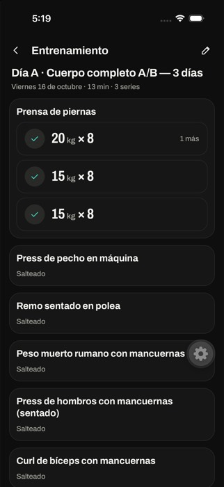 S19 | 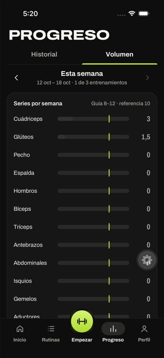 Volumen |
| 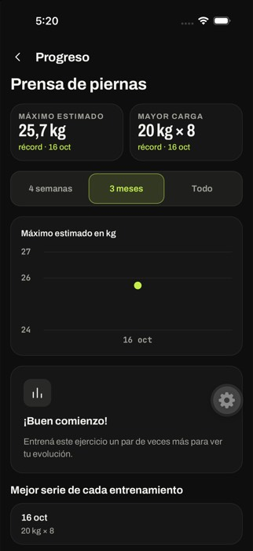 S20 | 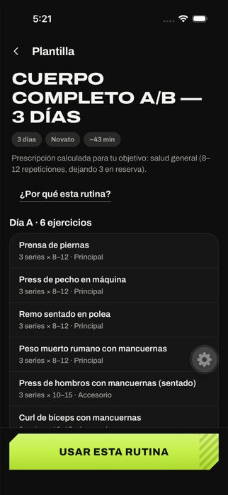 S14 | |
