# Recorrido completo en modo avión (#52)

**Fecha:** 14 de octubre de 2026.
**Dispositivo:** emulador Pixel_10 (Android 16) con el development build, en **modo avión** durante todo el recorrido.
**Punto de partida:** datos de la app borrados (`pm clear`), como recién instalada.

Cierra F5. Comprueba que los cuatro RF del TPO (09 §1) funcionan sin conexión de punta a punta, con RNF-01, RNF-02 y RNF-03.

## Resultado

| Criterio | Resultado | Evidencia |
|---|---|---|
| **RF01** · la rutina queda guardada y activa sin conexión, y el inicio muestra su próximo día | ✅ | Onboarding, recomendación y «Empezar con esta rutina» llevan a Inicio con el Día A. Editar la rutina (subir un ejercicio) se refleja al instante en Inicio. |
| **RF02** · cada serie queda guardada de inmediato, persiste aunque la app se cierre, y se retoma en el mismo punto | ✅ | Serie de calibración, descanso, matar el proceso 0,5 s después de confirmar la serie 2, y al reabrir S09 tiene las dos series y el descanso con el tiempo restante real. Finalizar con D10 muestra el resumen S12 y el próximo día pasa a ser B. |
| **RF03** · completar el tope del rango en todas las series sube la carga y vuelve al piso | ✅ | Con 80 kg × 12 × 3 en Prensa de piernas, la próxima sugerencia es **85 kg × 8** («¡Completaste 3 × 12! Subimos a 85 kg.»). |
| **RF04** · historial, corrección del pasado, evolución del e1RM, récords y volumen | ✅ | El historial muestra el entrenamiento. En S19 se corrigen dos series y se agrega una olvidada, y la sugerencia cambia de inmediato. Están S20 con su récord y S18 Volumen, con 3 series de cuádriceps y 1,5 de glúteos (fraccional). |
| **RNF-01** · nada requiere conexión | ✅ | Todo el recorrido se hizo en modo avión. |
| **RNF-02** · una serie confirmada persiste al matar el proceso | ✅ | Ver RF02. |
| **RNF-03** · confirmar una serie responde en menos de 100 ms en un teléfono de gama media | ⏳ | **No se puede medir en el emulador.** Se mide en un teléfono físico (limitación conocida, como RNF-23). La escritura es local y sincrónica; en el emulador la serie quedó guardada antes de los 0,5 s del kill. |
| **RNF-14** · historial y gráficos fluidos con 1.000 entrenamientos | ✅ | Medido en #39 con datos sintéticos en una build de release. El historial da p50 de 17 ms y p90 de 27 ms por frame, y S20 abre en menos de 1 s. |

## Bugs encontrados

| Issue | Qué | Estado |
|---|---|---|
| #140 | En la calibración, escribir la carga se sumaba al «—» del campo («—80») y la serie no se registraba. | Corregido en #142. |
| — | El máximo estimado se mostraba con dos decimales («125,22 kg»); el diseño usa uno. | Corregido en #142. |
| #141 | Con 1.000 entrenamientos, el arranque en frío tarda unos 7 s hasta que Inicio deja de cargar. Cada observador relee todo el historial. | Abierto: ninguna RNF fija el arranque. Propuesto para F9. |

## Capturas

| | | |
|---|---|---|
|  S01 |  S06 | 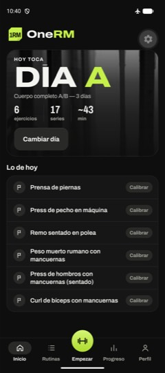 S07 |
| 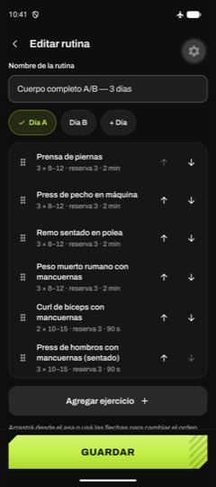 S15, ejercicio movido | 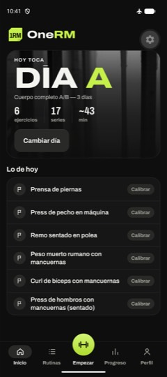 S07 con el cambio | 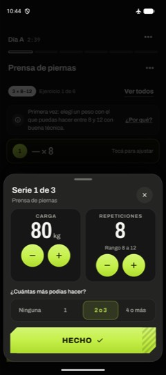 Calibración (#140 corregido) |
| 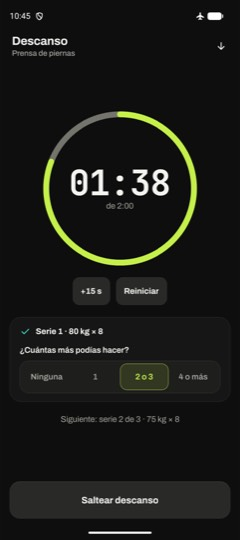 Descanso | 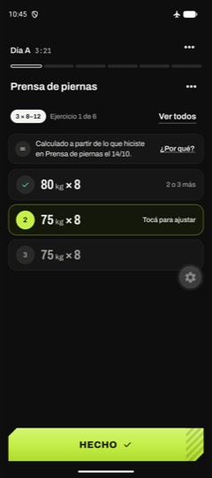 Antes de matar el proceso | 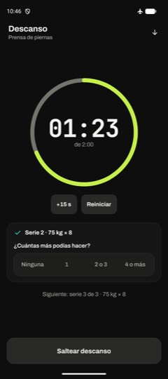 Al reabrir: serie 2 y descanso |
| 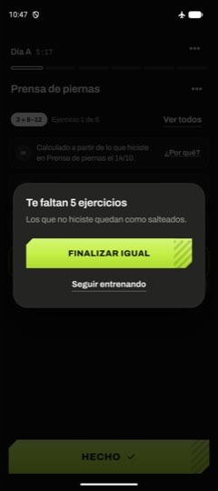 D10 | 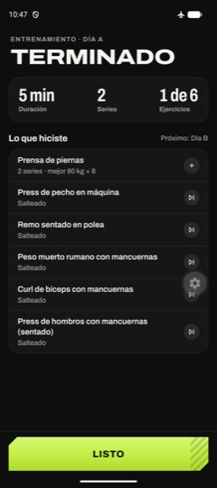 S12 | 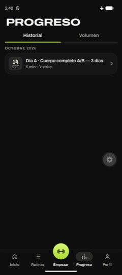 S18 |
| 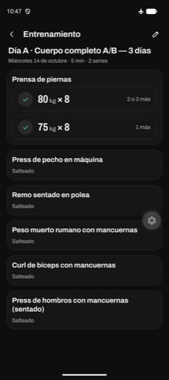 S19 |  S19 corregido | 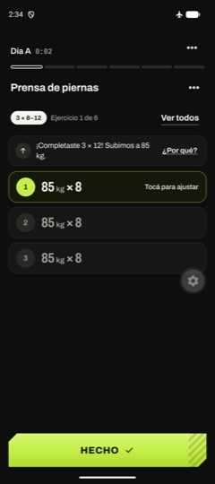 RF03: 85 kg × 8 |
| 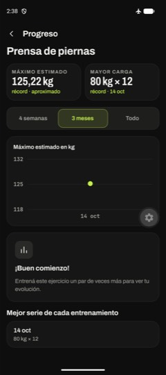 S20 | 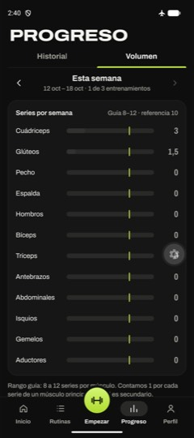 S18 Volumen | |

## Pendiente para una persona

- **RNF-03** en un teléfono físico de gama media, en modo avión:
  1. Empezar un entrenamiento.
  2. Tocar «Hecho» en una serie precargada.
  3. Verificar que la fila pasa a hecha y el teléfono vibra sin demora perceptible.
  4. Para medirlo, grabar la pantalla en cámara lenta, o activar el monitor de rendimiento de React Native y mirar el frame de la confirmación.
